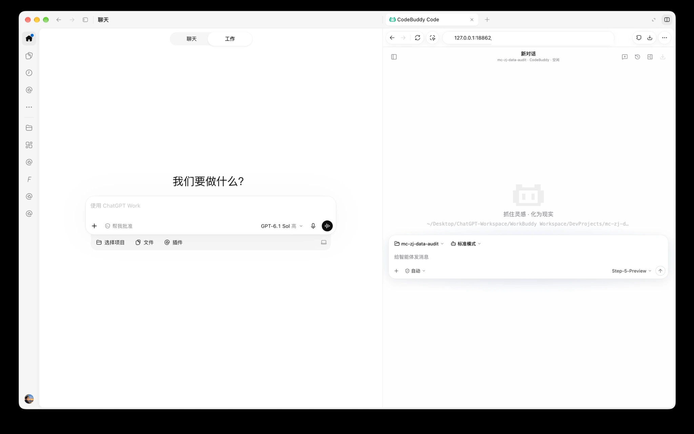
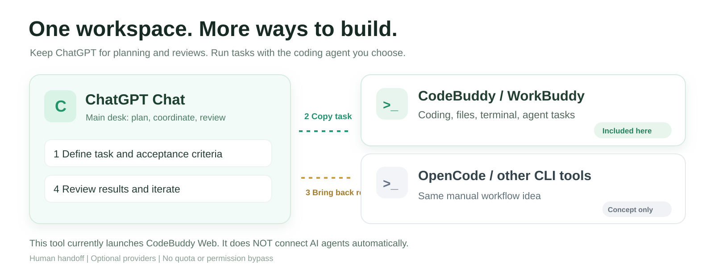
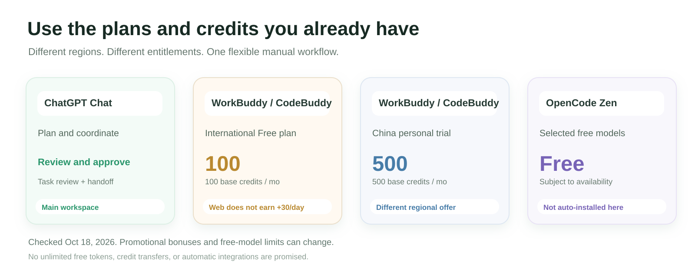

# ChatGPT + WorkBuddy — Side-by-Side Workspace

**English** · [简体中文](README.zh-CN.md)

**One workspace. Multiple AI options. Less app switching — and more ways to use the free credits you already have.**

Plan, coordinate, and review your work in **ChatGPT Chat**, while **CodeBuddy CLI** handles coding, terminal commands, file edits, and agent execution in its **official local Web UI**. Place them side by side in a compatible desktop client, or use two tiled windows.



> **Actual setup, not a fabricated UI.** The screenshot shows **ChatGPT Work** selected on the left and CodeBuddy's official local Web UI on the right. The author also uses **Chat mode** for planning and reviewing. Whether a local webpage can be embedded in a side panel depends on your ChatGPT/client version; tiled windows are a fallback. This repository does **not** add a ChatGPT side panel or enable automatic communication between AI tools.

[**Install**](#-install-on-macos--windows) · [**Step-by-step English guide**](docs/INSTALL_WITH_CODEX.md) · [**Report a bug / Suggest a feature**](https://github.com/dhy365-creator/chatgpt-workbuddy-workspace/issues/new/choose) · [**Contribute**](CONTRIBUTING.md)

## ✨ Why does this project exist?

You probably already have an AI assistant you like. But coding agents live in separate tools, which means switching apps, repeating context, and manually reviewing results. This project provides **one more practical AI development workflow**:

- **ChatGPT Chat** — clarify goals, break down tasks, write acceptance criteria, review results.
- **CodeBuddy CLI / WorkBuddy ecosystem** — use CodeBuddy's native Web UI to run programming agents, edit files, and execute tests.
- **You** — hand the task brief to CodeBuddy and return its commit links or test output to ChatGPT. **Human-in-the-loop**, not automatic cross-agent messaging.
- **Your existing Codex workflow stays intact.** This is an additional execution option, not a Codex replacement.



### 💸 Free credits can make another workflow worth trying

**You don't have to subscribe to every coding-agent provider to experiment with the tools they offer.** Different platforms have different free tiers, trial credits, free models, and paid subscription allowances. Use them only where you are eligible, under each provider's current terms.

| Provider / account region | Official free-plan information | Important distinction |
| --- | --- | --- |
| **WorkBuddy / CodeBuddy — International** | **100 base credits/month**. | A limited-time **30/day activity bonus** exists, but **Web conversations/tasks do NOT qualify**; only eligible activity through official WorkBuddy/CodeBuddy clients counts under the promotion rules. |
| **WorkBuddy / CodeBuddy — China** | **500 base credits/month** on the domestic personal trial tier. | **Not** the same entitlement as the international Free plan. |
| **OpenCode Zen** | Certain listed models are marked **Free**. | Free-model availability, limits, and provider requirements vary. **This repository does not install OpenCode.** |

Sources: [WorkBuddy international pricing](https://www.workbuddy.ai/docs/workbuddy/pricing) · [CodeBuddy international pricing](https://www.codebuddy.ai/docs/ide/Account/pricing) · [China domestic plan](https://www.workbuddy.cn/docs/workbuddy/Pricing) · [OpenCode Zen](https://opencode.ai/docs/zen/). Checked October 18, 2026; **always confirm current terms**. See the [international activity policy](https://www.codebuddy.ai/docs/workbuddy/Subscription): **Web-initiated conversations/tasks do not count toward the 30/day activity promotion**. No unlimited tokens, credit transfers, or quota bypasses are promised.



### 🌍 One CLI, different regional account sign-ins

Tencent's **official CodeBuddy CLI** offers both **Chinese Site** and **International Site** authentication choices. Overseas users can choose **International Site** when they log in through the official product; the npm package used for the CLI is still `@tencent-ai/codebuddy-code`.

[CodeBuddy's official English CLI quickstart](https://www.codebuddy.ai/docs/cli/quickstart) documents the regional login choices. **This project does not switch your account region, grant credits, or guarantee that every feature works in every country.** The author has tested local Web startup on Mac and Windows, but has not independently validated every international account's model access.

## 🔁 The side-by-side workflow (no automatic AI-to-AI messaging)

1. **Plan in ChatGPT Chat:** explain the desired result, deliverables, and tests.
2. **Run in CodeBuddy Web:** copy the task into the agent on the right; let the official CLI execute.
3. **Bring back evidence:** copy non-sensitive test results, file diffs, or Git commit links.
4. **Review in ChatGPT:** approve the result or request another iteration.

This is **side-by-side use with manual handoff**. Simply installing this package does **not** give ChatGPT Chat access to your computer, your credentials, or CodeBuddy's API.

Other CLI agents (such as OpenCode) can be used with a **similar manual workflow** if they provide a suitable terminal or Web UI. **This project currently installs and launches CodeBuddy only.**

## 🚀 Install on macOS & Windows

Choose either installation route. Neither requires the author's private Local MCP tools.

### Option A — Give the repository URL to Codex

Open a **Codex session with authorized access to your local computer** and send:

> Install this project for me: https://github.com/dhy365-creator/chatgpt-workbuddy-workspace

Codex can read [AGENTS.md](AGENTS.md) and the [English walkthrough](docs/INSTALL_WITH_CODEX.md), check your environment, request a project folder, install the helper and launch the official Web UI. **No lengthy install prompt to copy.** Local command execution still requires normal user/host permissions; an unsolicited URL alone is not approval.

### Option B — Install directly with npm (no Codex required)

You need Node.js **18.20+**, npm and Git. From a terminal:

```bash
npm install -g github:dhy365-creator/chatgpt-workbuddy-workspace#v0.2.2
```

Then choose an **existing folder you have approved** as CodeBuddy's working directory.

**macOS:**
```bash
workbuddy-web install --project "/Users/you/Projects/demo"
```

**Windows (CMD / Windows Terminal):**
```bat
workbuddy-web.cmd install --project "C:\Users\you\Documents\demo"
```

`workbuddy-web install` checks for the **official** `@tencent-ai/codebuddy-code` CLI, installs it via npm if missing, and starts its native local Web UI. The helper does **not** run any hidden `postinstall` script or bundle Tencent's binaries.

Open **http://127.0.0.1:18862/** on **your own computer**, enter the **local Web password shown in the private local startup log**, and finish your **personal CodeBuddy account login**. International users should follow the official **International Site** login instructions if they are eligible. Do not share passwords, `?password=` URLs, cookies, QR codes, or private logs in Issues or AI chats.

The default port is local-only. If another app uses 18862, the launcher refuses to terminate it automatically — choose another free port instead. A selected project directory is **not** an OS-level filesystem sandbox.

**Useful commands:**
```bash
workbuddy-web doctor
workbuddy-web status
workbuddy-web start
workbuddy-web stop
```

📸 **[Follow the nine real Windows installation screenshots in the English walkthrough](docs/INSTALL_WITH_CODEX.md).** The screenshots reflect an actual Chinese-language installation, so interface labels may differ for international users.

**Language of the install-success/Star prompt:** it follows your terminal language by default. To override, use `WORKBUDDY_WEB_LANG=en` or `WORKBUDDY_WEB_LANG=zh-CN` in the environment when running `workbuddy-web install`. This changes only the helper's optional messaging, **not** the official CodeBuddy Web UI or account region.

### ⭐ Optional GitHub Star after successful installation

After a successful `workbuddy-web install`, the helper offers **one optional** link to this repository. In an interactive terminal, answer **y** to open the GitHub project page; after 15 seconds without a response it skips the prompt. In a non-interactive Codex environment, the helper only prints the link.

**No automatic starring. No GitHub credentials collected. No penalty if you skip.**

## 🐛 Report issues and contribute

Everyone can help improve the project — you do **not** need to wait for the author to find a bug.

- [**Report an installation problem / Bug**](https://github.com/dhy365-creator/chatgpt-workbuddy-workspace/issues/new/choose)
- [**Request a feature / Share an idea**](https://github.com/dhy365-creator/chatgpt-workbuddy-workspace/issues/new/choose)
- [**Contribute via a Pull Request**](https://github.com/dhy365-creator/chatgpt-workbuddy-workspace/pulls) — read [CONTRIBUTING.md](CONTRIBUTING.md)
- [**Report a vulnerability privately**](https://github.com/dhy365-creator/chatgpt-workbuddy-workspace/security/advisories/new)

Please include your OS, Node/npm/official CodeBuddy versions, steps to reproduce, expected/actual behavior, and **redacted** diagnostics. **Never post credentials, real client documents, authentication QR codes, or private conversation history.**

## 🔐 Security and scope

- CodeBuddy's **official CLI** provides the models, sessions, slash commands, and `/goal` support; this third-party project provides an installer/launcher, not a replacement AI frontend.
- The Web is bound to **`127.0.0.1` only**, with a password, `--agent cli`, and `--permission-mode auto`. No `--auth none`, public listeners, or `bypassPermissions`.
- The helper safeguards private local logs: POSIX `0700/0600` on macOS, restricted NTFS ACL on Windows. Your CodeBuddy account and models remain under the provider's terms.
- The author sometimes uses a separate personal **Local MCP Toolset** with ChatGPT Chat. It is **not part of this repository**, is not required for the manual workflow, and is not documented here.
- No automatic system reboot startup is promised. Follow your client's permissions and check `workbuddy-web status` if you close Codex.
- This project is **independent**, **not affiliated with OpenAI, Tencent, or the OpenCode project**. Third-party UI and trademarks remain their owners' property. See [THIRD_PARTY_NOTICES.md](THIRD_PARTY_NOTICES.md).

## 🧪 Developer notes

```bash
npm test
npm pack --dry-run
```

Original launcher code: [bin/](bin/) · Tests: [tests/](tests/) · CI: [.github/workflows/](.github/workflows/).

The original launcher code and written documentation are licensed under [MIT](LICENSE); this does not grant rights in third-party brands or UI screenshots. Feedback and contributions are welcome.

**Want to share this project on X?** One sentence: *“Use ChatGPT as your planning and review desk, run coding tasks in CodeBuddy next door, and explore the free credits your region actually offers — one side-by-side workspace, no automatic AI-to-AI messaging required.”*

## ☕ Connect with the maintainer · Community & optional setup help

Want to exchange ideas about **AI learning, multi-agent workflows, or this project**? You're welcome to reach me on **WeChat** or **Telegram**.

If you prefer hands-on assistance, you can also ask about **Codex installation, local MCP setup, and related development-environment configuration or troubleshooting**. **One-to-one setup assistance may be a paid service**; availability, scope, and fees are agreed directly before any work begins. This is an independent, optional service—not an official OpenAI or Tencent offering.

| WeChat · **Harvey_AI_365** | Telegram · [**@HARVEY_AI_365**](https://t.me/HARVEY_AI_365) |
| :---: | :---: |
| <a href="https://github.com/dhy365-creator/chatgpt-workbuddy-workspace/blob/main/.github/assets/contact-wechat-harvey-ai-365.jpeg"></a> | <a href="https://github.com/dhy365-creator/chatgpt-workbuddy-workspace/blob/main/.github/assets/contact-telegram-harvey-ai-365.jpeg"></a> |
| Scan with WeChat · Click to enlarge | [Message on Telegram](https://t.me/HARVEY_AI_365) · Click to enlarge |

**Using this open-source project and its self-service documentation is free; no purchase or private contact is required.** For reproducible bugs and feature requests, please use [GitHub Issues](https://github.com/dhy365-creator/chatgpt-workbuddy-workspace/issues/new/choose), so the community can benefit from the answers.

Please do **not** send passwords, API keys, authentication QR codes, private conversations, or client files in an initial message.
