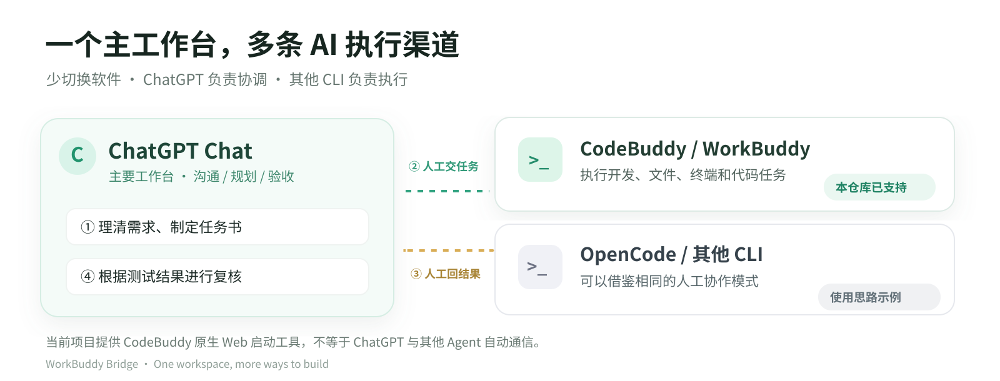
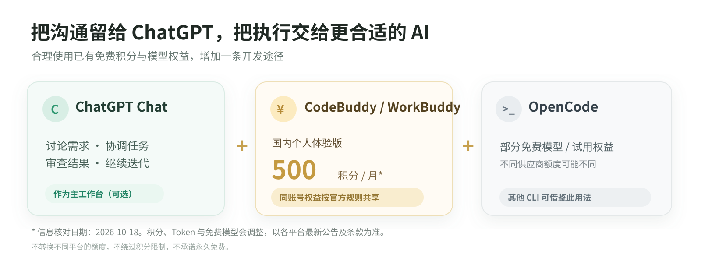

[**English**](README.md) · **简体中文**

# ChatGPT + WorkBuddy 同屏工作台

**一个窗口，两个 AI。ChatGPT 负责沟通与验收，CodeBuddy 负责执行开发任务。**

用 ChatGPT Chat 作为日常主工作台，在支持右侧网页面板的客户端中打开本地 CodeBuddy Web，减少反复切换 App。更重要的是：**按各平台规则利用已有免费积分、免费模型或订阅权益，为自己增加一条低成本的 AI 开发途径。**


> 📷 **真实 Mac 工作界面。** 左侧截图当时处于 ChatGPT 的 **Work** 页面，右侧是 CodeBuddy 官方原生 Web；作者在 Mac/Windows 也实际使用 **Chat 模式**沟通与验收。右侧面板属于所用客户端的界面能力，不是本项目制造的 ChatGPT 组件；客户端不支持网页侧栏时，可采用浏览器或系统并排窗口。本项目不提供自动跨 AI 通信。

[🚀 安装说明](#-快速安装mac--windows) · [📸 九张真实安装截图](docs/INSTALL_WITH_CODEX.zh-CN.md) · [🐛 反馈问题 / 提建议](https://github.com/dhy365-creator/chatgpt-workbuddy-workspace/issues/new/choose) · [🤝 参与贡献](CONTRIBUTING.zh-CN.md)

### 🌍 国内版与国际版都可以尝试

海外用户使用的国际版 **CodeBuddy / WorkBuddy** 也提供 Free 计划。根据官方 2026-10-18 的公开定价信息，国内个人体验版基础额度为 **每月 500 积分**；国际版 Free 计划为 **每月 100 基础积分**，还可能获得符合条件的 **每日 30 积分限时活跃奖励**。两套权益属于不同地区的官方政策。**国际版限时每日 30 积分活动明确不计入网页端发起的对话或任务**；只有符合活动条件的官方客户端活动才可能计入。**不能将国内 500 积分当作海外额度，也不能宣称无限免费 Token**。

国际用户可以使用相同的官方 `@tencent-ai/codebuddy-code` CLI，首次登录按官方页面选择 **International Site（国际站）**，然后使用本项目的启动工具。此流程的海外账户登录细节尚未由作者逐区验证，实际支持情况以当地服务与个人账号为准。

官方：[国内体验版](https://www.workbuddy.cn/docs/workbuddy/Pricing) · [国际版 Free 价格](https://www.workbuddy.ai/docs/workbuddy/pricing) · [CodeBuddy 英文登录说明](https://www.codebuddy.ai/docs/cli/quickstart) · [国际版官方活跃奖励细则](https://www.codebuddy.ai/docs/workbuddy/Subscription)。

## ✨ 为什么值得尝试？

- **少切换软件**：在 ChatGPT 聊天窗口旁打开 CodeBuddy 本地 Web，边讨论任务，边查看执行结果。
- **多一条开发途径**：ChatGPT Chat 做需求整理、代码评审与验收；CodeBuddy CLI 可以执行文件、终端、代码开发等具体任务，**并非取代 Codex**。
- **合规利用已有免费权益**：腾讯 CodeBuddy / WorkBuddy 国内个人**体验版**官方列示 **500 基础积分/月**，同账号积分共享；OpenCode Zen 官方列有部分标记为 **Free** 的模型。按照各平台具体地区、账号与限制使用，不承诺永久免费、无限 Token 或不同平台额度互转。
- **不重新开发聊天前端**：本仓库是第三方的 CodeBuddy **官方原生 Web 启动与安全配置工具**，模型选择、Agent、会话及 `/goal` 等功能均由官方 CLI 提供。





**官方权益参考：** [CodeBuddy / WorkBuddy 个人定价](https://www.codebuddy.cn/docs/ide/Account/pricing) · [OpenCode Zen 模型与价格](https://opencode.ai/docs/zen/)。上述政策会调整，请以使用当日官方实际权益为准。

## 🔁 一种简单、可复现的协作流程

1. **ChatGPT Chat**：沟通需求，制定任务书、测试与验收条件。
2. **CodeBuddy Web / CLI**：将任务交给 Agent，执行开发、文件操作或测试。
3. **人工交接**：将提交记录、测试结果或执行报告反馈给 ChatGPT。
4. **ChatGPT Chat**：复核结果，指出问题，需要时再交给 Agent 修复。

**关键区别：这是“同屏协作 + 人工交接”，不是 ChatGPT 与 CodeBuddy 自动互发消息。** 不要求作者的私人 MCP 工具，也没有绕过 ChatGPT 或 CodeBuddy 的权限规则。

本仓库当前**只负责 CodeBuddy CLI 的原生 Web 部署**。OpenCode、OpenClaw 及其他 CLI 仅是可以借鉴同屏协作思路的工具，并未通过本仓库完成一键安装或自动互通。

## 🚀 快速安装（Mac / Windows）

有两种方式；**不需要作者自行开发的 Local MCP**。

### 方式 A：把仓库地址发给 Codex

在能执行本机命令的 Codex 中发送：

> 帮我安装这个项目：https://github.com/dhy365-creator/chatgpt-workbuddy-workspace

Codex 可读取仓库根目录的 [AGENTS.md](AGENTS.md) 与 [详细安装指南](docs/INSTALL_WITH_CODEX.md)，依照你给予的权限检查环境、安装必要依赖、让你选择本地项目目录并启动 CodeBuddy Web。**不需要复制长篇 Prompt。** 需要的文件操作与系统权限仍须正常审批。

### 方式 B：自己使用 npm 安装（无需 Codex）

电脑需要 **Node.js ≥18.20**、npm、Git，以及你本人有权使用的 CodeBuddy 账号。安装启动工具：

```bash
npm install -g github:dhy365-creator/chatgpt-workbuddy-workspace#v0.2.2
```

选择**已存在的、经你同意的项目目录**，完成官方 CodeBuddy CLI 检测/按需安装并启动 Web：

**macOS 示例：**
```bash
workbuddy-web install --project "/Users/you/Projects/demo"
```

**Windows Terminal / CMD 示例：**
```bat
workbuddy-web.cmd install --project "C:\Users\you\Documents\demo"
```

运行成功后，在本机浏览器打开 **http://127.0.0.1:18862/**，从**自己电脑的启动终端或私有日志**查看本地 Web 登录密码，并按官方流程登录 CodeBuddy 账号。首次密码输入与扫码登录需要本人完成；**不要把密码、带密码参数的完整 URL、二维码或私有日志发到 GitHub Issue / AI 对话中。**

如果 18862 已被其他服务占用，工具会拒绝覆盖；让 Codex 或自己选择其他空闲端口。项目工作目录不等于操作系统级的权限沙箱。

**常用命令：**
```bash
workbuddy-web doctor
workbuddy-web status
workbuddy-web start
workbuddy-web stop
```

安装包本身不会通过 `postinstall` 自动运行服务；只有你明确执行 `workbuddy-web install --project ...` 才会启动。本仓库**不捆绑腾讯官方 CLI**。

📸 [查看 Windows 真实安装流程、双层密码与扫码登录的九张图解](docs/INSTALL_WITH_CODEX.zh-CN.md)。

**安装成功与 Star 邀请语言：**默认跟随本机终端语言，也可以在启动命令前使用环境变量 `WORKBUDDY_WEB_LANG=zh-CN` 或 `WORKBUDDY_WEB_LANG=en` 选择中英文。该设置不影响官方 CodeBuddy Web 的显示语言或账号地区。

### ⭐ 安装后欢迎自愿点一个 Star

当 `workbuddy-web install` **成功启动本地 Web** 后，会显示一次可选 Star 邀请：交互式终端按 `y` 才打开本仓库主页，15 秒无回应默认跳过；Codex 等非交互式窗口只会显示项目链接。**不会自动点 Star、不会要求 GitHub 登录信息、不会因为不点 Star 而阻止使用。**

喜欢这种“ChatGPT + AI 执行工具”的工作方式，欢迎给仓库点一个 ⭐。

## 🐛 遇到问题？直接向作者反馈

**GitHub Issues 对外开放，欢迎所有用户参与优化。** 你可以报告 Mac / Windows 安装问题、提出改进建议或分享适配经验：

- [**提交 Bug / 安装问题**](https://github.com/dhy365-creator/chatgpt-workbuddy-workspace/issues/new/choose)（选择「Bug / 安装问题」）
- [**提出功能建议**](https://github.com/dhy365-creator/chatgpt-workbuddy-workspace/issues/new/choose)（选择「功能建议」）
- [**贡献修复 Pull Request**](https://github.com/dhy365-creator/chatgpt-workbuddy-workspace/pulls)（先读 [贡献说明](CONTRIBUTING.md)）

请提交操作系统、Node/npm/CodeBuddy 版本、复现步骤与**已脱敏**的错误信息；**严禁提交密码、Token、Cookie、真实会话、账号二维码或客户资料**。安全漏洞请走 [私密安全报告](SECURITY.zh-CN.md)，不要直接公开利用细节。

## 🔐 权限、安全与功能边界

- **本地专用**：CodeBuddy 官方 Web 仅监听 `127.0.0.1`，使用本地 Web 密码、`--agent cli` 和默认 `--permission-mode auto`；不会开启 `0.0.0.0` 或绕过审批。
- **两层登录**：本地 Web 密码 ≠ CodeBuddy 官方账号；是否能调用模型和实际免费积分取决于个人账户及官方服务。
- **数据在自己电脑**：本项目不提供云端代理服务，不收集模型 API Key；Windows 私人配置与密码日志使用受限 ACL，macOS 遵循 `0700/0600`。
- **不是自动互联插件**：人工复制任务及执行结果；作者额外使用自己开发的 Local MCP Toolset，但它不在本仓库中，也不是用户使用此方案的前提。
- **没有开机自启承诺**：后台服务持续性已测试；系统重启后的自启需要单独配置。本项目不是腾讯、OpenAI 官方产品或其授权代理。

## 🧩 开发与社区

安装器的源代码位于 [bin/](bin/)，安全测试位于 [tests/](tests/)，跨平台 GitHub Actions 在 [.github/workflows/](.github/workflows/)。可以运行：

```bash
npm test
npm pack --dry-run
```

建议先通过 [Issue](https://github.com/dhy365-creator/chatgpt-workbuddy-workspace/issues/new/choose) 讨论变更，再提交 PR。作者根据复现证据、兼容性和安全要求决定是否合并；开源意味着人人可以反馈，不代表每一条需求都会立即实现。

## 📄 许可证与版权说明

本项目原创启动工具代码及文档以 [MIT License](LICENSE) 开源。CodeBuddy、WorkBuddy、ChatGPT、OpenCode 等名称和第三方界面/标识归各自权利人所有；示范截图仅用于说明使用过程，**不属于本仓库 MIT 许可证授予的第三方软件或商标权利**。详见 [第三方声明](THIRD_PARTY_NOTICES.zh-CN.md)。本仓库不提供或重新分发腾讯官方 CLI 二进制。

## 💬 联系作者｜AI 交流与可选安装协助

欢迎就 **ChatGPT + WorkBuddy 同屏工作台、AI 学习交流及多 AI 协作**与我交流，可以通过以下微信或 Telegram 联系。

如果你希望有人协助完成 **Codex 安装部署、本地 MCP 工具配置，或相关开发环境的排障和调试**，也可以联系我咨询。**一对一安装及技术配置可能属于有偿服务**，具体内容、报价与时间以双方事先沟通确认为准；这是作者独立提供的可选协助，并非 OpenAI 或腾讯官方服务。

| 微信 · **Harvey_AI_365** | Telegram · [**@HARVEY_AI_365**](https://t.me/HARVEY_AI_365) |
| :---: | :---: |
| <a href="https://github.com/dhy365-creator/chatgpt-workbuddy-workspace/blob/main/.github/assets/contact-wechat-harvey-ai-365.jpeg"></a> | <a href="https://github.com/dhy365-creator/chatgpt-workbuddy-workspace/blob/main/.github/assets/contact-telegram-harvey-ai-365.jpeg"></a> |
| 使用微信扫码 · 点击可查看原图 | [直接在 Telegram 联系](https://t.me/HARVEY_AI_365) · 点击可查看原图 |

**本项目代码和自助安装教程继续免费开源，无需付费，也不需要添加好友才能使用。** 一般性的安装 Bug 和功能建议，建议优先通过 [GitHub Issues](https://github.com/dhy365-creator/chatgpt-workbuddy-workspace/issues/new/choose) 提交，方便其他使用者一起参考和交流。

为保护账户和隐私，初次联系请不要发送密码、API Key、登录二维码、私人对话记录或客户资料。
