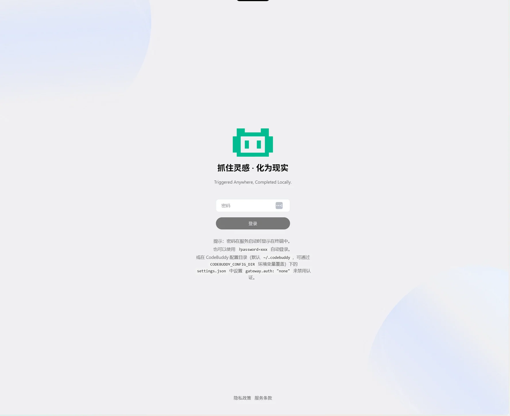
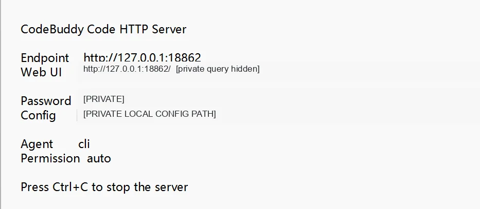
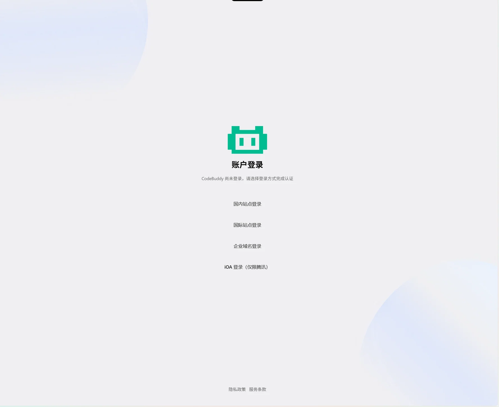
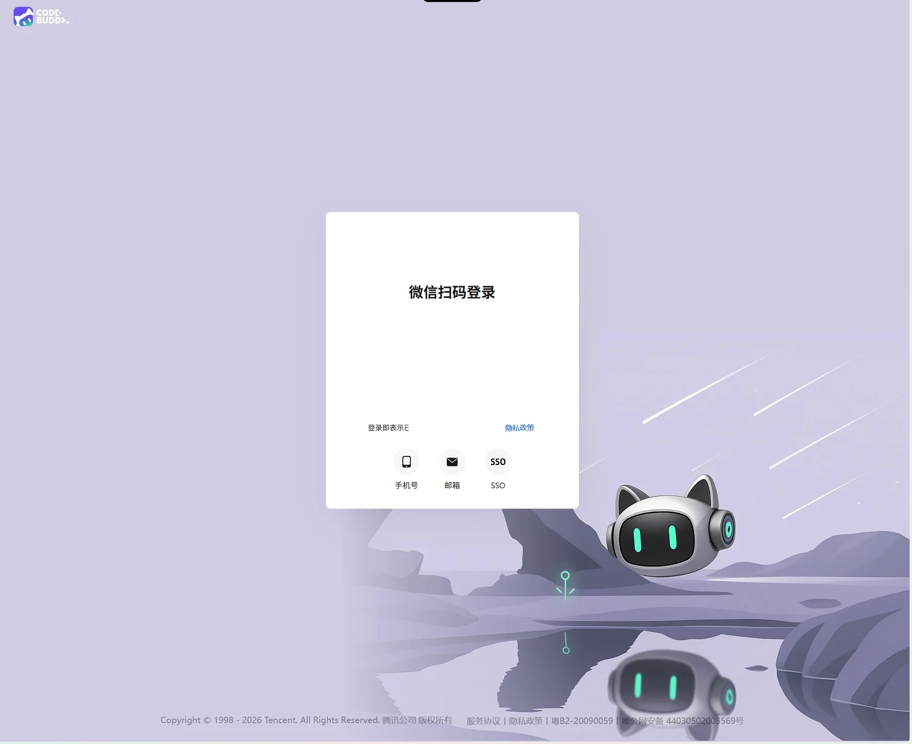
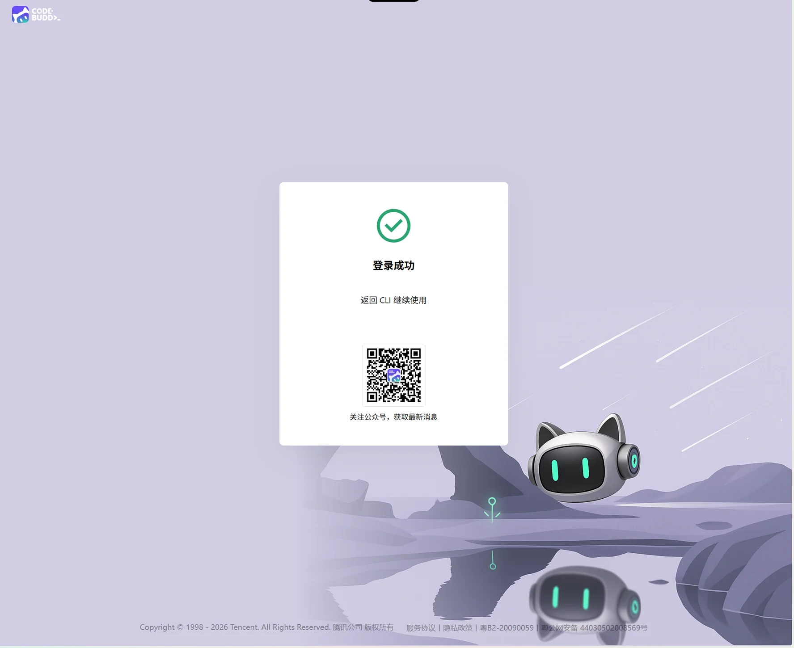
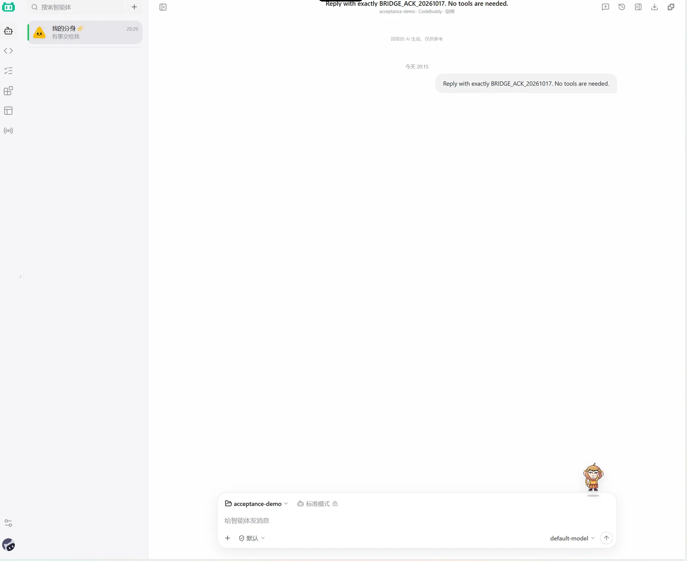
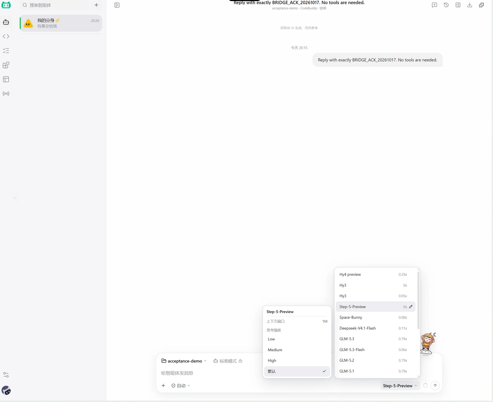
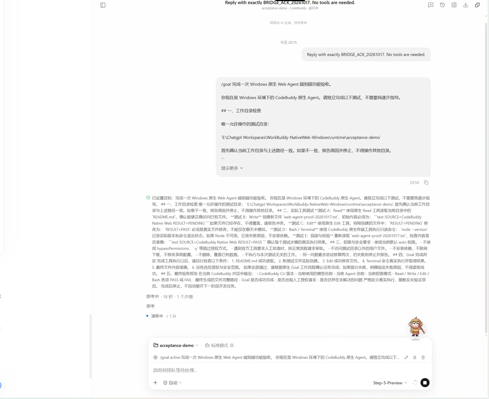
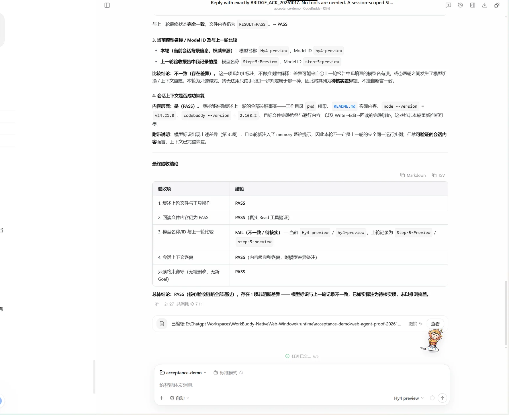

[**English**](INSTALL_WITH_CODEX.md) · **简体中文**

# ChatGPT + WorkBuddy 同屏工作台｜安装与使用图解

项目地址：[chatgpt-workbuddy-workspace](https://github.com/dhy365-creator/chatgpt-workbuddy-workspace) · [问题反馈](https://github.com/dhy365-creator/chatgpt-workbuddy-workspace/issues/new/choose)

**本项目让 CodeBuddy CLI 启动官方本地 Web，便于与 ChatGPT 同屏协作。** ChatGPT 负责沟通、审核，CodeBuddy 负责具体执行；任务与结果目前通过**人工交接**，不是两个 AI 自动互联。

> 🌐 **国际版提示：** 海外用户使用相同 `@tencent-ai/codebuddy-code` CLI；首次官方登录应按自身地区选择 International Site。WorkBuddy 国际版 Free 基础额度为每月 100 积分，不同于国内体验版每月 500 积分；**每天 30 积分的限时活跃奖励不计入网页端发起的对话与任务**，需使用符合规则的官方客户端并满足活动条件。参见 [国际版官方定价](https://www.workbuddy.ai/docs/workbuddy/pricing) 和 [CLI 登录选择](https://www.codebuddy.ai/docs/cli/quickstart) 和 [官方每日活跃细则](https://www.codebuddy.ai/docs/workbuddy/Subscription)。

## 两种安装方式

### A. 把仓库地址交给 Codex（推荐）

在能操作你电脑的 Codex 中发送一句：

> 帮我安装这个项目：https://github.com/dhy365-creator/chatgpt-workbuddy-workspace

Codex 获取仓库后按根目录 [AGENTS.md](../AGENTS.md) 和 README 安装，不需要你复制长 Prompt。它会检查 Node.js（≥18.20）、npm、Git、CodeBuddy CLI，确认你授权的本机项目目录，再通过 npm 安装、配置和启动 Web。**操作系统/Codex 权限审批、个人账号登录仍需用户参与。**

仅发送裸 URL、没有安装意图，不代表允许它对电脑执行命令。普通 ChatGPT Chat 不具备自动获取本地终端的默认权限。

### B. 手动使用 npm 安装（不需要 Codex）

```bash
npm install -g github:dhy365-creator/chatgpt-workbuddy-workspace#v0.2.2
```

然后在对应系统的终端运行：

**Mac：**
```bash
workbuddy-web install --project "/Users/you/Projects/demo"
```

**Windows（CMD 或 Windows Terminal；.cmd 可规避某些 PowerShell 执行策略的限制）：**
```bat
workbuddy-web.cmd install --project "C:\Users\you\Documents\demo"
```

项目目录必须**已经存在**，并由你明确授权。如果没有官方 CodeBuddy CLI，`workbuddy-web install` 会在这条明确的安装命令执行时尝试安装腾讯官方 npm 包。不会在 `npm install -g github:...` 阶段偷偷启动服务。首次 CodeBuddy 登录需要由你本人完成。

### 安装完成后的地址

```text
http://127.0.0.1:18862/
```

网页使用 **CodeBuddy 官方原生 Web**，不是仓库另造的网页。**本地 Web 密码**和**个人 CodeBuddy 官方账号**是两层独立认证；本地服务 HTTP 200 不代表官方账号已登录。

**私密信息请只在自己的电脑查看，绝不向 Codex、ChatGPT 或 GitHub Issue 粘贴真实密码或带 `?password=` 的完整 URL。**

## 九张 Windows 真机安装与操作截图

这些截图来自作者实际 Windows 部署过程：为了让读者理解真实 UI，保留可公开的 CodeBuddy 页面与演示步骤，仅对敏感认证材料做**局部处理**。图中的扫码页面已移除临时认证二维码；扫码请使用你自己电脑上最新出现的二维码。

### 01｜打开本地 Web，出现密码登录页



### 02｜从自己电脑查看启动信息和 Web 密码

启动终端或仅当前用户可读的本地日志会显示 endpoint、登录密码及 Agent/Permission。下面仅隐去了密码、可复用的密码 URL 和私人配置路径，其余启动参数保留。



### 03｜输入 Web 密码后，进入 CodeBuddy 账号登录

本地密码只是第一层。官方模型服务仍依赖你自己的 CodeBuddy 账号。



### 04｜根据官方页面提示登录／扫码

示例里的临时二维码已移除，不能用于登录。你自己的二维码必须在自己设备上操作，不能公开分享。



### 05｜账号登录成功

官方成功页面会提示返回 CLI 或原生 Web 继续使用。



### 06｜进入原生 Web 聊天、选择项目目录

确认当前项目目录与你之前批准的路径相同；只设置工作目录**不是 OS 级沙箱**。



### 07｜选择账号可用模型与权限

使用原生模型菜单；具体模型是否开放以个人 CodeBuddy 权益为准。默认 `auto` 不代表敏感工具操作会无限制自动执行。



### 08｜按需执行 Agent 或 `/goal` 演示

演示来自原生 Web 的真实测试过程。Goal 可能连续消耗额度，**安装器不会在用户不知情时自动执行**。



### 09｜审查真实任务结果与测试证据

安装成功、账号登录和模型任务执行是三个不同验收层次；未实际使用账户/模型的安装不能宣称已完成模型调用验收。



## 安装成功后的使用与维护

```bash
workbuddy-web --version
workbuddy-web doctor
workbuddy-web status
workbuddy-web start
workbuddy-web stop
```

`stop` 仅会尝试终止经过身份验证、由本工具创建的实例。占用端口属于其他服务时，不会自动停止它；不要直接按名称批量结束 Node 或 CodeBuddy 进程。

在支持本地网页的 ChatGPT 右侧面板打开 `http://127.0.0.1:18862/`，即可在同一窗口与 ChatGPT 并列使用；客户端不支持时可以使用系统并排窗口。作者实际用过个人 Local MCP 增强本机操作，但**本开源仓库不安装、不要求、不讲解其私人 MCP**。

### ⭐ 自愿支持作者

当 `workbuddy-web install` 确认 Web 已成功启动，会显示一次 GitHub Star 邀请：终端用户按 `y` 后仅打开 GitHub 项目页面，最终是否点 Star 由本人决定；15 秒不回应就跳过。在 Codex 等非交互式执行环境只显示链接，不等待输入，不会自动点赞。

### 有问题直接反馈到 GitHub

[打开 **Issues / 提交问题**](https://github.com/dhy365-creator/chatgpt-workbuddy-workspace/issues/new/choose)。请选择「Bug / 安装问题」或「功能建议」，说明系统、Node/npm/CLI 版本及复现步骤，不要贴密码、Token、Cookie、临时二维码或私人工作目录内容。

### 已知边界

- 目前是 **CodeBuddy-only** 的第三方 Web 启动工具；OpenCode 等产品只是人工协作思路示例，未被这个包自动安装或集成。
- **ChatGPT Chat 不会因为安装此包就自动获得操作本机的权限。** 两个 AI 通过人传任务和结果，不是自动相互通信。
- 不自动建立系统级开机启动。关闭 Codex 后服务是否继续运行，请用 `workbuddy-web status` 检查。
- 默认绑定 `127.0.0.1`、本地密码认证和 `auto` 权限，禁止 `--auth none`、`0.0.0.0` 和 bypassPermissions。
- 本项目不提供腾讯官方二进制，也不代表腾讯或 OpenAI 官方。

参考：[CodeBuddy 官方安装](https://www.codebuddy.cn/docs/cli/installation) · [官方 Web UI](https://www.codebuddy.cn/docs/cli/web-ui)。
